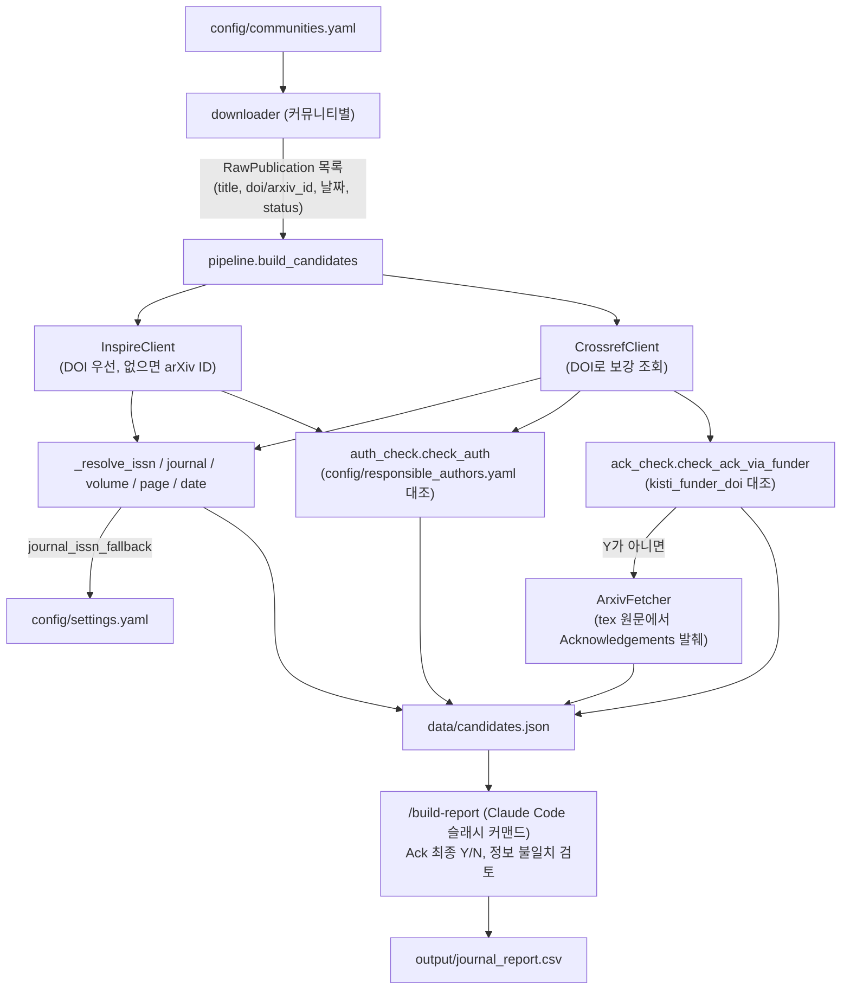

# journal_info_collector

KISTI/GSDC가 지원하는 실험 커뮤니티(CMS, ALICE, Belle II, LIGO)의 논문 목록을
각 커뮤니티 공식 게시 페이지에서 수집하고, INSPIRE-HEP·CrossRef로 서지정보를
보강한 뒤, "이 논문에 KISTI/GSDC 담당자가 저자로 참여했는지(Auth)"와
"사사(Acknowledgements)에 KISTI/GSDC가 언급됐는지(Ack)"를 판정해 보고서용
CSV(`output/journal_report.csv`)를 만드는 파이프라인이다.

## 전체 흐름



`main.py fetch`가 A\~K까지를 담당하고, 사사(Ack)의 최종 Y/N 판정과 원본 대비
서지정보 불일치 검토는 `.claude/commands/build-report.md`(`/build-report`
슬래시 커맨드)에서 LLM이 `data/candidates.json`을 읽어 수행한다(L~M).

## 실행

```bash
pip install -r requirements.txt

# 커뮤니티별 논문 목록 다운로드 + INSPIRE/CrossRef 조회 + Auth 판정 + Ack 발췌
python main.py fetch [--community CMS ALICE ...] [--year 2026] [--limit N]

# "computing centres는 감사하는데 KISTI/GSDC는 전혀 언급 안 된" 논문 찾기
python main.py scan-ack-gap [--community CMS ...] [--year 2026 | --since-days 730] [--limit N]
```

`fetch` 결과는 `data/candidates.json`에 쌓이고, 이후 Claude Code에서
`/build-report`를 실행하면 `output/journal_report.csv`가 만들어진다.

## 커뮤니티별 다운로더 — 논문 목록을 어떻게 찾아내는가

커뮤니티 판별은 "INSPIRE에서 검색"하는 방식이 아니라, **각 커뮤니티가
공식적으로 게시하는 논문 목록 페이지를 그대로 스크래핑**하는 방식이다.
`config/communities.yaml`에 커뮤니티별 `url`과 `downloader` 키가 정의돼
있고, `src/downloaders/registry.py`의 `DOWNLOADERS` 딕셔너리가 그 키를
실제 다운로더 클래스로 연결한다(`src/downloaders/base.py`의
`BaseDownloader.fetch()`를 구현). 각 다운로더는 사이트 구조가 서로 달라서
파싱 방식도 제각각이다:

| 커뮤니티 | 소스 | 파싱 방식 |
|---|---|---|
| CMS | `CMS_publications.csv` | `csv.DictReader`로 바로 파싱. `DOI`/`Reference` 컬럼으로 상태(published/submitted/accepted/superseded) 판정 |
| ALICE | `alice-publications.web.cern.ch/publications` | 페이지네이션 있는 HTML 테이블(`views-table`)을 BeautifulSoup으로 순회. 행마다 `<li>` 텍스트가 `"Article reference: ..."`로 시작하면 그 안의 `doi.org` 링크로 DOI 추출. DOI 없는 논문(미출판)은 제외 |
| Belle II | `docs.belle2.org/pub_data/publications/` | 페이지네이션 있는 HTML 테이블(`table-hover`). 4번째 컬럼이 링크면 `published`+DOI, 텍스트만 있으면 `"published"`/`"submitted"` 접두어로 상태 판정. 날짜 컬럼이 없어 arXiv ID(`YYMM.NNNNN`)에서 연-월을 근사(`date_filter.arxiv_id_to_date`) |
| LIGO | `pnp.ligo.org/ppcomm/Papers.html` | 단일 페이지 HTML 테이블(`<tbody id="Table">`). "Journal citation" 셀 텍스트에서 정규식 `doi:(\S+)`로 DOI를 뽑아냄. LSC/Virgo/KAGRA 공동 논문도 전부 `LIGO`로 표시 |

새 커뮤니티를 추가할 때는 `BaseDownloader`를 상속한 클래스를 만들고
`registry.py`의 `DOWNLOADERS`에 키를 등록한 뒤 `communities.yaml`에
설정만 추가하면 된다.

다운로더가 반환하는 각 논문은 아직 "출판됨이 확정"이 아닐 수 있다
(`RawPublication.status` — `submitted`/`accepted`/`preprint`/`unknown` 포함).
DOI가 없어도 일단 목록에 포함시키고, 실제 출판 여부는 다음 단계에서
INSPIRE-HEP으로 다시 확인한다.

## INSPIRE-HEP과의 결합 (`src/pipeline.py`, `src/inspire_client.py`)

1. **조회 우선순위** — `_resolve_inspire_record()`: 다운로더가 준 DOI가
   있으면 `GET /doi/{doi}`로 먼저 조회한다. 못 찾거나 DOI 자체가 없으면
   `GET /arxiv/{arxiv_id}`로 재조회한다. arXiv 경로가 필요한 이유는 두
   가지다: (a) 출판사에서 막 DOI가 발급됐는데 INSPIRE의 `dois` 필드
   반영이 며칠 지연되는 경우, (b) 원본 페이지엔 아직 DOI가 없지만
   INSPIRE는 이미 출판을 인지한 "숨은 출판" 케이스.
2. **effective DOI** — 원본에 DOI가 없어도 INSPIRE 레코드에 DOI가 있으면
   그걸 최종 DOI로 채택하고(`effective_doi`), 이 값의 존재 여부로
   `publication_status`를 `"published"`로 확정한다.
3. **필드 매핑** — INSPIRE 레코드에서 `journal_title`/`journal_volume`/
   `page`(`artid` 우선, 없으면 `page_start`)/`pub_date`(`imprints[0].date`,
   없으면 `preprint_date`)/저자 목록(`full_name`+ORCID)/`collaborations`를
   가져온다. 제목은 출판사(APS 등) 버전엔 MathML이 섞여 있는 경우가 많아
   **arXiv 소스로 등록된 title을 우선** 사용한다.
4. **ISSN** — journal record를 가리키는 `$ref` URL을 한 번 더 조회해
   ISSN을 얻는다(`_get_journal_issn`, `_journal_cache`로 URL별 캐싱해
   중복 조회 방지).
5. **CrossRef 보강** — `effective_doi`가 있으면 CrossRef `/works/{doi}`도
   조회해서(`src/crossref_client.py`) ORCID·ISSN·출판일을 보강한다.
   INSPIRE 저자에는 ORCID가 비어 있는 경우가 있어 CrossRef 저자 목록과
   합쳐서 쓴다.
6. **최종 ISSN 결정** (`_resolve_issn`) — 우선순위: ① CrossRef가 준
   `issn_list[0]`, ② INSPIRE의 `issn`, ③ 둘 다 없으면
   `config/settings.yaml`의 `journal_issn_fallback`을 저널명(short_title)
   으로 조회. fallback 값은 `"print_ISSN,EISSN"` 형식으로 저장돼 있고,
   print ISSN이 있으면 그걸, 없으면(electronic-only 저널) EISSN을 쓴다.

## 저자(Auth) 판정 — 어느 문서를 참고하는가

`config/responsible_authors.yaml`이 기준 문서다. 커뮤니티별로 KISTI/GSDC
담당자 명단(`name`, `orcid`)을 등록해두고, `src/auth_check.py`의
`check_auth()`가 이 명단을 INSPIRE + CrossRef 저자 목록과 대조한다.

- **ORCID가 있으면 이름 대조는 생략**하고 ORCID만으로 판정한다(오탐 방지).
  INSPIRE 저자의 ORCID와 CrossRef 저자의 ORCID를 합친 풀(`orcid_pool`)에
  담당자 ORCID가 있으면 `"Y"`.
- **ORCID가 없으면** 이름을 알파벳 토큰 집합으로 쪼개(`_name_tokens`,
  쉼표 제거 후 소문자 알파벳 단어만 추출) 논문 저자 이름 토큰 집합의
  부분집합인지 확인한다. 매칭되면 `"확인필요"`(표기 차이로 오탐 가능성이
  있어 사람이 다시 봐야 함을 의미)로 판정하고, 매칭이 없으면 `"N"`.
- INSPIRE 레코드를 아예 못 찾은 논문은 대조 자체가 불가능하므로
  `"확인불가"`로 표시한다(`pipeline.py`).

`responsible_authors.yaml`의 주석에도 있듯, ORCID를 채우는 걸 강력히
권장한다 — 이름만으로는 표기 순서(성/이름)나 철자 차이로 오탐이 날 수
있기 때문이다.

## Funder ID(사사) 판정 — funder_id는 어떻게 골라내는가

KISTI의 CrossRef FundRef DOI는 `config/settings.yaml`의
`crossref.kisti_funder_doi` (`10.13039/501100003708`) 하나로 고정돼 있고,
이 값을 기준으로 `src/ack_check.py`의 `check_ack_via_funder()`가 CrossRef
서지정보에 붙어 있는 `funder` 배열과 대조한다. 판정은 3단계다:

1. CrossRef 레코드 자체가 없거나 `funder` 목록이 비어 있으면 → `None`
   (이 출판사는 FundRef 메타데이터를 등록하지 않음 → 아래 arXiv 원문
   판정으로 넘어감).
2. `funder` 목록의 DOI 중 `kisti_funder_doi`와 정확히 일치하는 게 있으면
   → `"Y"` (예: APS/Phys.Rev. 계열은 사사 문구엔 "MSIT and NRF"만 보여도
   구조화된 funder 목록엔 KISTI DOI가 들어있는 경우가 실제로 확인됨).
3. DOI가 일치하지 않아도, funder **이름** 문자열에
   `"Korea Institute of Science and Technology Information"`(대소문자
   무시, 정규식 매칭)이 있으면 → `"Y"`로 판정한다. 이 이름-기반 보조
   판정이 필요한 이유는, 일부 출판사가 KISTI를 이름은 정확히 적어놓고도
   DOI는 **KIST**(Korea Institute of Science and Technology,
   `10.13039/501100003693` — 이름만 비슷한 별개 기관)로 잘못 태깅해둔
   사례가 실제로 확인됐기 때문이다. 그래서 `KISTI_NAME_RE`는 "Information"
   이 붙은 전체 명칭만 매칭하도록 좁혀서 KIST와 구분한다.
4. 위 조건을 모두 못 만족하면 → `"N"`이지만, 이 `"N"`은 최종 판정이
   아니다. Elsevier/Springer 등 일부 출판사는 사사 문단을 자동
   텍스트마이닝해서 funder 목록을 만드는 것으로 보이는데, 원문에 분명히
   있는 기관이 통째로 빠진 채로 목록이 채워진 사례가 있어 **"목록이
   있다"가 "완전하다"를 보장하지 않는다.**

그래서 `pipeline.py`는 `"Y"`가 나온 경우만 그대로 신뢰하고, `"N"`이나
`None`(즉 `"Y"`가 아닌 모든 경우)에는 항상 `src/arxiv_fetcher.py`로
arXiv LaTeX 원문을 내려받아 Acknowledgements 절 발췌(`ack_excerpt`)를
추가로 만든다. arXiv e-print(tar.gz 또는 단일 gzip)를 풀어서 `.tex`/`.txt`
파일들을 모으고, `ack_filename_hints`(`config/settings.yaml` —
`"fa_"`(ALICE의 funding-acknowledgement 파일), `"ack"`, `"acknowledg"`)
우선순위로 정렬한 뒤, `"acknowledg"`가 나오는 위치 앞뒤로 텍스트를 잘라
발췌를 만든다. 이 발췌 안에 KISTI/GSDC가 실제로 언급됐는지의 **최종
Y/N/미확인 판정은 이 코드가 하지 않고**, `data/candidates.json`을 읽는
`/build-report` 단계(LLM)에서 표기 차이("KISTI" 축약형 vs 전체 기관명 vs
"GSDC"/"Global Science ... Data hub Center" 등)까지 감안해 판단한다.

## 그 외 참고

- **날짜 필터링**(`src/date_filter.py`): `--year`/`--since-days`는 파싱 가능한
  날짜에만 적용되고, 날짜를 못 읽으면 안전하게 포함시킨다.
- **최종 CSV 스키마**(`src/csv_writer.py`): `No., title, journal, ISSN, Vol,
  Page, coll., date, IF, JCI percentile, DOI, Auth, Ack` — `No.`는 항상 CSV
  작성 시점에 순서대로 다시 매겨진다.
- **개인정보**: `config/responsible_authors.yaml`에는 KISTI/GSDC 담당자의
  실명과 ORCID가 들어있다. ORCID는 연구자 공개 식별자이므로 이 저장소에
  포함해 커밋한다.
- **생성물 제외**: `data/`, `output/`은 `fetch`/`build-report` 실행 시마다
  재생성되는 산출물이라 `.gitignore`로 제외돼 있다.
