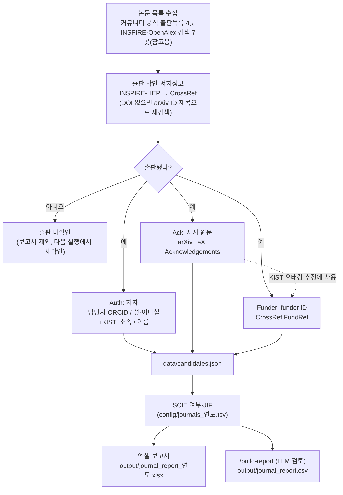

# journal_info_collector

KISTI/GSDC가 지원하는 실험 커뮤니티의 연간 출판 논문을 모아, 각 논문이
**KISTI 유발 논문**인지 판정하는 파이프라인이다. 유발 논문은 SCIE 저널 논문이면서
아래 세 근거 중 하나 이상이 있는 논문이다.

| 근거 | 확인 대상 | 확인 방법 |
|---|---|---|
| **Auth** (저자) | KISTI/GSDC 담당자가 저자인가 | INSPIRE·CrossRef 저자 목록과 담당자 명단 대조 |
| **Ack** (사사) | 사사 원문에 KISTI/GSDC가 있는가 | arXiv TeX 원문의 Acknowledgements 검색 |
| **Funder** (funder ID) | 출판사 메타데이터에 KISTI funder ID가 있는가 | CrossRef FundRef 조회 |

세 근거는 서로 대신하지 않는다. 출판 논문마다 셋을 **모두 따로 확인**해 각 컬럼에 적는다.

## 전체 흐름



## 실행

```bash
pip install -r requirements.txt

# 수집·조회·근거 판정. --year만 주면 대조 보고서·저널 목록·엑셀까지 만든다.
python main.py fetch --year 2026 [--community CMS ...] [--limit N]

python main.py report    --year 2026   # 엑셀만 다시 만들기
python main.py reconcile --year 2026   # 커뮤니티·INSPIRE·OpenAlex 대조 보고서
python main.py journals  --year 2026   # SCIE/JIF 조사용 저널 목록
python main.py scan-ack-gap --year 2026  # 컴퓨팅 센터는 감사하는데 KISTI는 빠진 논문 찾기
```

CSV는 Claude Code에서 `/build-report`로 만든다(`.claude/commands/build-report.md`).
정기 실행은 `scripts/scheduled_fetch.sh [연도]`를 쓴다.

| 산출물 | 내용 |
|---|---|
| `output/journal_report_<연도>.xlsx` | 요약 탭 + 커뮤니티별 탭 + 출판 미확인 탭 |
| `output/journal_report.csv` | 판정 대상 커뮤니티 최종 보고서 |
| `output/journal_report_reference.csv` | 참고용 커뮤니티 보고서 |
| `output/reconcile_report.md` | 출처별로 한쪽에만 있는 논문(누락 의심) |
| `output/journals_<연도>.txt` | JCR에서 SCIE·JIF를 찾아 넣을 저널 목록 |

## 1. 논문 목록 수집 (`src/downloaders/`)

| 커뮤니티 | 목록 소스 | 다운로더 |
|---|---|---|
| CMS | `cms-results.web.cern.ch/cms-results/public-results/publications/CMS/CMS_publications.csv` | `cms_csv` |
| ALICE | `alice-publications.web.cern.ch/publications` | `alice_html` |
| Belle II | `docs.belle2.org/pub_data/publications/` | `belle2_html` |
| LIGO | `pnp.ligo.org/ppcomm/Papers.html` | `ligo_html` |
| DUNE, JSNS2, HK/SK, RENE, FCC, EIC | INSPIRE-HEP 컬래버레이션 검색 | `inspire_collab` |
| ENIGMA | OpenAlex 검색 | `openalex_search` |

- 위 4곳은 커뮤니티 공식 출판목록을 그대로 읽는다. 나머지 7곳은 공식 목록이
  없거나 읽을 수 없어 검색 결과를 쓴다(DUNE 목록은 Cloudflare 봇 차단에 막혀 있음).
- 이 7곳은 `reference_only: true`인 **참고용**이다. 판정은 똑같이 하지만 유발논문
  집계와 최종 보고서에서 빠진다.
- 공식 목록에 없어도 INSPIRE 컬래버레이션 출판 목록이나 OpenAlex KISTI 검색
  (KISTI funder·KISTI 소속·담당자 ORCID)에서 찾은 논문은 보충한다.
- 커뮤니티 추가: `BaseDownloader.fetch()`를 구현하고 `registry.py`에 등록한 뒤
  `config/communities.yaml`에 항목을 넣는다.

## 2. 출판 확인 (`src/pipeline.py`)

목록의 논문은 투고·게재확정 단계일 수 있다. DOI가 확보되면 출판으로 본다.

1. 목록의 DOI로 INSPIRE를 조회하고, 없으면 arXiv ID로 조회한다
   (목록엔 DOI가 없는데 INSPIRE는 출판을 아는 경우).
2. 그래도 DOI가 없으면 INSPIRE 출판 목록에서 같은 제목을 찾고,
   마지막으로 OpenAlex에서 제목으로 찾는다(`OPENALEX_API_KEY` 필요).
3. DOI가 있으면 CrossRef로 저자 ORCID·ISSN·게재일·funder를 보강한다.
   게재일은 CrossRef와 INSPIRE 중 이른 날짜(온라인 게재일)를 쓴다. ISSN은 CrossRef를
   우선하고, 없으면 `config/settings.yaml`의 `journal_issn_fallback`을 쓴다.

## 3. KISTI 유발 근거 판정

### Auth (`src/auth_check.py`)

`config/responsible_authors.yaml`의 커뮤니티별 담당자 명단과 대조한다.

| 값 | 조건 |
|---|---|
| `Y` | ORCID 일치, 또는 성·이니셜이 같고 그 저자의 소속이 KISTI |
| `확인필요` | 이름만 일치(표기 차이로 오탐 가능) |
| `N` | 일치 없음 |
| `확인불가` | INSPIRE·CrossRef 저자 목록을 구하지 못함 |

### Ack (`src/arxiv_fetcher.py`)

arXiv e-print를 받아 사사 영역에서 "KISTI", "Korea Institute of Science and
Technology Information", "GSDC", "Global Science (experimental) Data hub
Center"를 찾는다. KIST(Information 없음)는 별개 기관이라 인정하지 않는다.
결과는 `Y` / `N` / `미확인`(원문을 못 구함)이고, `/build-report`가 발췌를 보고
정규식이 놓친 표기가 있는지 다시 확인한다.

### Funder (`src/ack_check.py`)

CrossRef funder 목록에서 KISTI funder ID(`10.13039/501100003708`)를 찾는다.
출판사가 KISTI를 **KIST**(`10.13039/501100003693`)로 잘못 등록한 사례가 있어
오태깅을 구분한다.

| 값 | 조건 | 근거 인정 |
|---|---|---|
| `Y` | KISTI ID가 정확히 등록됨 | O |
| `KIST오태깅` | KIST ID인데 이름이 KISTI이거나, 사사 원문엔 KISTI만 있음 | O (수정 요청) |
| `이름만` | KISTI 이름은 있으나 ID가 비어 있음 | O (ID 추가 요청) |
| `KIST확인` | KIST ID가 있으나 오태깅인지 판단 불가 | X (사람 확인) |
| `N` / 없음 | KISTI 항목 없음 / 출판사가 funder를 등록 안 함 | X |

Funder가 `N`이어도 KISTI 지원이 없다는 뜻은 아니다. 일부 출판사는 funder 목록을
불완전하게 채우므로 Ack를 따로 확인한다.

## 4. SCIE 판정과 보고서 (`src/jcr.py`, `src/csv_writer.py`, `src/xlsx_report.py`)

- SCIE 여부·JIF·상위%는 사람이 JCR에서 정리한 `config/journals_<연도>.tsv`를
  ISSN으로 매칭해 채운다. 표에 없는 저널은 `python main.py journals`로 뽑아 추가한다.
- `유발논문` = SCIE이고 Auth·Ack·Funder 중 하나 이상이 근거로 인정될 때 `Y`.
  ISSN이 없거나 SCIE가 아니면 `N`, 표에 없는 저널이면 보류다.
- 엑셀 행 색: 녹색(유발논문), 파란색(공식 목록에 출판 표기), 노란색(INSPIRE·OpenAlex로만
  출판 확인), 회색(그 외).
- 논문별 수동 메모는 `config/paper_notes.yaml`에 DOI로 적으면 `비고`에 붙는다.

## 설정 파일

| 파일 | 내용 |
|---|---|
| `config/communities.yaml` | 커뮤니티별 목록 소스·다운로더·INSPIRE 검색식·참고용 여부 |
| `config/responsible_authors.yaml` | 커뮤니티별 담당자 이름·ORCID (ORCID 권장) |
| `config/settings.yaml` | API 주소, KISTI funder ID, ISSN fallback, 출력 경로, 캐시 |
| `config/journals_<연도>.tsv` | JCR SCIE·JIF 표 (라이선스 문제로 커밋 안 함) |
| `config/paper_notes.yaml` | 논문별 수동 메모 |

## 참고

- INSPIRE·CrossRef 조회 결과와 확정된 근거 판정은 `data/cache.sqlite`에 캐시한다.
  미출판 논문은 캐시하지 않아 매 실행마다 출판 여부를 다시 확인한다.
- `data/`, `output/`은 실행할 때마다 다시 만들어지는 산출물이라 커밋하지 않는다.
- 담당자 ORCID는 공개 식별자라 `responsible_authors.yaml`에 넣어 커밋한다.
  공개하지 않을 메모는 `config/*.local.yaml`에 둔다.
